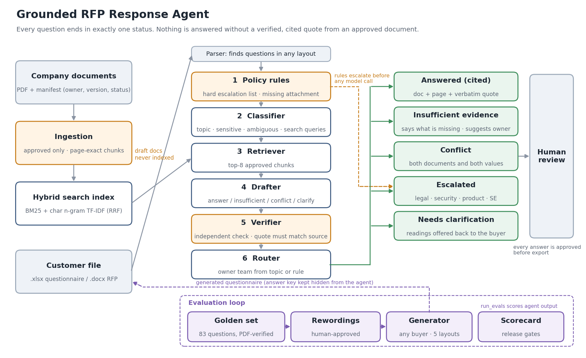

# Grounded RFP Response Agent

An AI agent that drafts answers to RFPs and security questionnaires using **only** a company's approved documentation. Every answer carries a verified, verbatim quote with document and page. When the documentation can't support an answer, the agent does one of three things instead of guessing: says so, flags the conflict, or routes the question to the right team.

> **Status:** Phase 0 (sample data + golden eval set) and Phase 1 (agents + eval runner) are built and tested offline. The first scorecard against a live model needs an Anthropic API key; see [Run it with your API key](#10-how-can-someone-run-it-locally). Phase 3 (review UI + write-back into the customer's file) is next.



## 1. What business problem does this solve?

Security questionnaires and RFPs take solutions engineers days per deal, and most of the questions repeat. The real risk is a confident wrong answer that becomes a contractual representation, not the time spent. This agent makes the repetitive majority fast and sends the risky remainder to the right people with evidence attached.

## 2. Who would use it?

- **Primary users:** solutions engineers and pre-sales teams.
- **Routed questions go to:** security, legal, and product.
- **Final submission:** proposal managers and deal desks own it.

## 3. What does the demo do?

Give it a customer questionnaire (`.xlsx`) or RFP (`.docx`) in any of several common layouts. Each question ends in exactly one status:

| Status | What the reviewer gets |
|---|---|
| **Answered** | Answer text built only from verified claims, plus document, page, and verbatim quote for each |
| **Insufficient evidence** | What's missing, the suggested owner, and related excerpts |
| **Conflict** | Both documents, both pages, and both values, routed to the owning team |
| **Escalated** | The team (legal / security / product / SE), the reason, and related excerpts |
| **Needs clarification** | The possible readings to send back to the buyer |

The output is `review.md` (grouped by status) plus `results.jsonl` (full trace per question). With an answer key, you also get a scored `scorecard.md`.

## 4. What is the architecture?

Per question (`agents/pipeline.py`):

1. **Policy rules** (`agents/policy.py`): hard escalation list and missing-attachment check. Runs before any model call.
2. **Classifier:** topic, sensitive?, ambiguous?, and 1–3 search queries in the documents' own vocabulary.
3. **Retriever:** hybrid BM25 + character n-gram TF-IDF, fused by reciprocal rank, over **approved chunks only**.
4. **Drafter:** chooses a status. Answers are written as claims, each citing passages.
5. **Verifier:** a separate model call checks each claim. Its quote must then appear **verbatim** in the cited chunk (checked in code), otherwise the claim is dropped.
6. **Router:** owner team from the rule or the topic taxonomy.

## 5. Which tools can the agents call?

| Tool | Module |
|---|---|
| `parse_questionnaire(file)` | `tools/parse_questionnaire.py`: finds questions in any supported layout and records where each answer belongs |
| `search_kb(query)` | `tools/search_kb.py`: approved documents only |
| `get_page(doc, page)` | `tools/kb_text.py` |
| `ingest()` | `tools/ingest.py`: approval gate plus page-exact chunks |
| `route` | `agents/policy.py` |
| `export_response` | *Phase 3* |

## 6. How do you prevent hallucinations?

- **The approval gate is enforced at indexing time.** The draft document in the sample corpus, which claims FedRAMP, HIPAA, and PCI, can never be retrieved.
- **The answer is exactly the verified claims.** No unverified sentence reaches the customer.
- **Verification has two layers.** A model check runs first, then a code check that the quote exists verbatim in the cited page.
- **Conflicts must be proven.** Each side's value must literally appear in its source, and the two sources must be different documents.
- **Rules run first.** Sensitive topics escalate before any model call.
- **A human approves every answer** before export.

## 7. How is the system evaluated?

- **Golden set:** 83 questions across the five required behaviors, machine-verified against the PDFs, plus 166 rewordings that a human approves before they count.
- **Generator:** builds new questionnaires for any buyer, category mix, section focus, and layout, each with a hidden answer key.
- **`evals/run_evals.py`:** scores a run against release gates.
- **Headline metric:** false-answer rate, gated at ≤ 2%. Citations of the unapproved draft are gated at 0.

| Offline check (no API key) | Result |
|---|---|
| Retrieval recall@8, covered questions (original / reworded) | 97% / 98% |
| Retrieval recall@8, conflicts, both sides found | 92% / 92% |
| Escalation rules on 249 wordings | 0 false positives, 0 misses |
| Full pipeline with a scripted "perfect model" on all 83 questions and on a generated reworded file | 100%, all gates pass |
| Adversarial scripted models (fabricated quote, fake citation, invented conflict, partial support) | all caught |

See [`evals/README.md`](evals/README.md).

## 8. How could it be deployed in an enterprise?

- SSO and RBAC per document collection.
- Document connectors (SharePoint, Confluence, Google Drive) that respect an approval workflow.
- Postgres/pgvector in place of the in-memory index.
- An audit log of every answer, source, and approver.
- VPC deployment.
- An approved-answer library that grows with each signed-off questionnaire.
- Nightly eval runs in CI against freshly generated questionnaires.

## 9. What are its limitations?

- **Not yet measured against a live model.** The offline tests prove the plumbing and guardrails, not answer quality.
- **The escalation rules were tuned on this question set.** The model classifier backs them up, but novel phrasings need monitoring.
- **Retrieval is lexical.** It's fine at this corpus size; a large corpus would add embeddings to the fusion.
- **The sample corpus is synthetic and clean.** Scanned PDFs and complex tables will parse worse.
- **Cross-answer consistency checking is not built yet.** Conflicts are detected between documents, not yet between two answers in the same questionnaire.
- **Legal wording still needs a lawyer.**

## 10. How can someone run it locally?

```bash
pip install -r requirements.txt
pytest -q                                   # 50 offline tests, no API key needed
python -m evals.retrieval_eval              # search quality, no API key needed
```

**Run it with your API key**

```bash
cp .env.example .env                        # then put your key in ANTHROPIC_API_KEY
python -m evals.run_evals data/sample/questionnaires/northgate_rfp.docx          # 20 questions, quick check
python -m evals.run_evals data/sample/questionnaires/northgate_security_questionnaire.xlsx   # all 83
# results: evals/results/<file>/scorecard.md and review.md
```

The full 83-question run makes roughly 150–200 model calls (questions caught by the policy rules make none). Identical calls are cached in `.cache/llm/`, so re-running is free.

**Generate new questionnaires and score them**

```bash
python -m tools.generate_questionnaire --buyer "Acme Health" --format xlsx --layout yes_no --count 40 --seed 7
python -m evals.run_evals data/generated/acme_health_xlsx_yes_no_s7.xlsx

python -m tools.generate_questionnaire --buyer "Borealis Bank" --format docx --layout table \
    --mix covered=8,not_covered=4,conflict=6,sensitive=5,ambiguous=3 \
    --sections "Data Protection,Compliance,Incident Response,Business Continuity,Legal and Commercial,General" \
    --reworded 0.5 --seed 11
```

Layouts: xlsx `standard | yes_no | by_section`, docx `numbered | table`.

**Approve rewordings** (they are used in scored runs only after approval)

```bash
python -m tools.rewordings export           # -> data/review/rewordings_review.xlsx
# fill the Decision column: approve / reject / edit
python -m tools.rewordings import
```

**Answer a real questionnaire** (no answer key needed): `python -m agents.run_questionnaire path/to/file.xlsx`

**Docker:** `docker compose run agent pytest -q`, or `docker compose run agent python -m evals.run_evals data/sample/questionnaires/northgate_rfp.docx`

## Repository layout

```
├── agents/         pipeline (classifier, drafter, verifier, router), policy rules, prompts, LLM client
├── tools/          ingest, search, questionnaire parser, generator + layouts, rewordings, corpus builder
├── data/sample/    fictional knowledge base (PDF) + sample questionnaires with answer keys
├── evals/          golden set, rewordings, validator, scoring, eval runner, retrieval eval
├── tests/          50 offline tests incl. scripted-model end-to-end runs
├── docs/           design decisions
├── architecture/   architecture diagram (generated by tools/draw_architecture.py)
└── app/            review UI + export (Phase 3)
```

*All companies and documents in this repository are fictional.*
